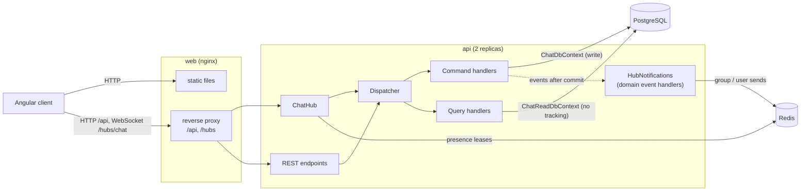
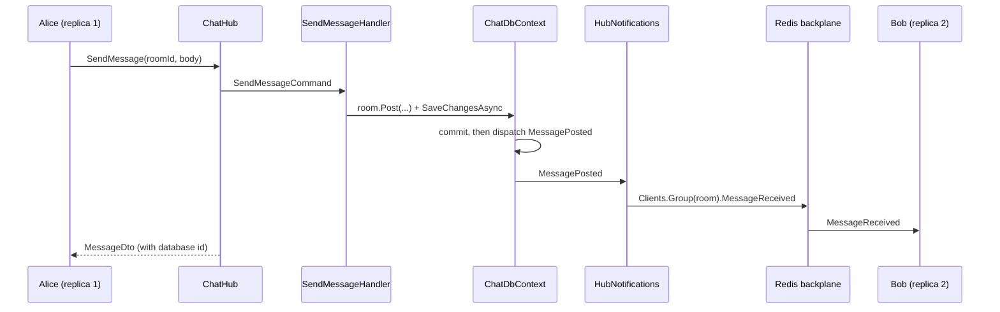

# realtime-chat-signalr

A real-time chat application: an ASP.NET Core 8 backend with a SignalR hub, and an
Angular 20 client.

- Public **channels** and **direct conversations** between two users
- **Presence** (online/offline) tracked per user across multiple connections, so a second
  tab or device keeps you online when the first closes; stored in Redis when running more
  than one instance
- **Typing indicators**, throttled on the server and expiring on their own on the client
- **Read receipts** and **unread counts**
- **Message history** with keyset paging, backwards for scrolling up and forwards for
  catching up after a reconnect
- **CQRS split**: commands write through EF Core to PostgreSQL; queries use a separate
  read-only context that can point at its own connection
- **Domain events** raised by the aggregates are dispatched after commit to a handler that
  pushes them to SignalR clients
- **Redis backplane** for running several API instances; the compose file starts two behind
  nginx

Sign-in uses a **development-only token endpoint** that issues a signed JWT for any user name
without a password. It stands in for a real identity provider and is disabled unless
`Auth:DevTokens:Enabled` is set.

## Architecture



Sending a message, end to end:



## Running it

### With Docker Compose

```bash
docker compose up --build
```

Then open <http://localhost:8088> in two browsers (or a normal and a private window), sign
in as two different users and message each other. The sidebar footer shows which API
replica each browser is connected to. When the two users are on different replicas, delivery
between them goes through the Redis backplane; `BackplaneTests` exercises that path with two
in-process API instances sharing one Redis.

The compose file starts:

| Service    | What it does                                                                 |
|------------|------------------------------------------------------------------------------|
| `postgres` | PostgreSQL 16, data in the `postgres-data` volume                              |
| `redis`    | Redis 7: SignalR backplane and presence store                                  |
| `migrate`  | Runs the API image with `--migrate`, applies EF Core migrations, then exits    |
| `api`      | Two replicas of the API, started after `migrate` has completed successfully    |
| `web`      | nginx serving the Angular build and proxying `/api` and `/hubs` to the replicas |

The compose stack enables the dev token endpoint and uses a fixed signing key so it works
out of the box. Set `CHAT_JWT_SIGNING_KEY` to override the key, and do not expose this stack
publicly as it is.

### Locally

Requirements: .NET 8 SDK and Node.js (the client was built with Node 24).

```bash
# API on http://localhost:5288 (Development profile)
dotnet run --project src/Chat.Api

# Client on http://localhost:4200, proxying /api and /hubs to the API
cd client
npm install
npm start
```

The Development profile (`appsettings.Development.json`) uses SQLite (`chat-dev.db`, created
on startup), the in-memory presence tracker and no backplane, so nothing else needs to be
running. To use PostgreSQL and Redis locally instead:

```bash
docker run -d --name chat-postgres -e POSTGRES_USER=chat -e POSTGRES_PASSWORD=chat -e POSTGRES_DB=chat -p 5432:5432 postgres:16-alpine
docker run -d --name chat-redis -p 6379:6379 redis:7-alpine

export Database__Provider=Postgres
export ConnectionStrings__Chat="Host=localhost;Database=chat;Username=chat;Password=chat"
export ConnectionStrings__Redis="localhost:6379"
dotnet run --project src/Chat.Api
```

With `Database:Provider=Postgres` the schema comes from the migrations in
`src/Chat.Infrastructure/Persistence/Migrations`; `MigrateOnStartup` applies them, or run
the API once with `--migrate`.

### Tests

```bash
dotnet test
```

- `Chat.UnitTests`: domain rules, the dispatcher, command and query handlers against SQLite
  in memory, the typing throttle, and a presence contract run against both trackers
- `Chat.IntegrationTests`: the whole API hosted with `WebApplicationFactory`, driven by the
  SignalR .NET client; `BackplaneTests` starts two instances that share a database and Redis
  and connects each user to a different one

The Redis presence tests and the backplane tests are skipped unless `CHAT_TEST_REDIS` is set:

```bash
docker run -d --rm --name chat-test-redis -p 6379:6379 redis:7-alpine
CHAT_TEST_REDIS=localhost:6379 dotnet test
```

CI (`.github/workflows/ci.yml`) builds and tests the backend with a Redis service, checks
that the migrations match the model, builds the Angular client and builds the compose images.

## Configuration

Settings use the normal ASP.NET Core configuration sources; in environment variables, `:`
becomes `__` (for example `ConnectionStrings__Redis`).

| Key | Default | Meaning |
|-----|---------|---------|
| `ConnectionStrings:Chat` | *(required)* | Write database connection string |
| `ConnectionStrings:ChatRead` | same as `Chat` | Connection for the query side, e.g. a read replica |
| `ConnectionStrings:Redis` | empty | When set: Redis presence and (by default) the backplane. When empty: in-memory presence, single instance only |
| `Database:Provider` | `Postgres` | `Postgres` or `Sqlite` |
| `Database:MigrateOnStartup` | `false` | Apply migrations (PostgreSQL) or create the schema (SQLite) at startup |
| `Redis:Backplane` | `true` | Use the SignalR Redis backplane when Redis is configured |
| `Redis:KeyPrefix` | `chat:` | Prefix for presence keys and backplane channels |
| `Auth:Jwt:Issuer` / `Audience` | `realtime-chat` | Token issuer and audience |
| `Auth:Jwt:SigningKey` | *(required, 32+ chars)* | HMAC-SHA256 signing key |
| `Auth:Jwt:TokenLifetimeHours` | `12` | Lifetime of issued tokens |
| `Auth:DevTokens:Enabled` | `false` | Map `POST /api/dev/token` (password-less, development only) |
| `Presence:LeaseSeconds` | `90` | How long a connection counts as alive without renewal |
| `Presence:RenewIntervalSeconds` | `30` | How often each instance renews its leases and sweeps expired ones |
| `Typing:ThrottleMilliseconds` | `3000` | Minimum gap between typing broadcasts per user and room |
| `Typing:IndicatorMilliseconds` | `6000` | How long clients show the indicator after a broadcast |

## API surface

All endpoints except the token endpoint require `Authorization: Bearer <token>`. The hub
accepts the token as the `access_token` query parameter, which is what the SignalR client
sends for WebSockets.

| Method | Path | |
|--------|------|-|
| POST | `/api/dev/token` | `{ "userName": "alice" }` returns a token (only when enabled) |
| GET | `/api/rooms` | Rooms you belong to, with unread counts |
| GET | `/api/rooms/unread` | Unread counts only |
| GET | `/api/rooms/{id}` | One room |
| GET | `/api/rooms/{id}/messages?before=&after=&limit=` | Keyset-paged history (limit 1-100) |
| POST | `/api/rooms/{id}/messages` | Send a message (same command as the hub) |
| GET | `/api/rooms/{id}/read-markers` | How far each member has read |
| POST | `/api/rooms/{id}/read` | `{ "messageId": 42 }` marks read up to a message |
| GET / POST | `/api/channels` | List channels / create one |
| POST | `/api/channels/{id}/join` | Join a channel |
| POST | `/api/direct` | `{ "userName": "bob" }` opens (or returns) the direct conversation |
| GET | `/api/users` | Users who have signed in |
| GET | `/api/presence` | Users online now |

Hub `/hubs/chat`: client-to-server `SendMessage`, `MarkRead`, `StartTyping`, `StopTyping`,
`GetOnlineUsers`, `GetConnectionInfo`; server-to-client `MessageReceived`, `ReadReceipt`,
`UserTyping`, `UserStoppedTyping`, `PresenceChanged`, `RoomAdded`, `MemberJoined`.

## Design decisions

**Commands and queries take different paths.** Command handlers load aggregates through
`ChatDbContext`, change them and save. Query handlers project straight to DTOs through
`ChatReadDbContext`, which has no change tracking, refuses to save and has its own
connection string. Both share one EF Core mapping, so there is one schema and one set of
migrations (owned by the write context).

**A hand-rolled dispatcher instead of MediatR.** One small class: handlers are found by
assembly scan and invoked through cached generic wrappers. It avoids a dependency whose
current versions are commercially licensed, and the indirection stays easy to follow.

**Domain events are dispatched after commit.** `ChatDbContext.SaveChangesAsync` collects the
events raised by tracked aggregates, saves, and only then dispatches them, so clients never
hear about a message that was rolled back. `MessagePosted` carries the entity because its
id is assigned by the database. A failing handler is logged rather than rethrown, because
the change has already been committed. This is not an outbox: if the process stops between
the commit and the dispatch, that push is lost (the message itself is saved, and clients
pick it up from history after their next reconnect).

**Broadcasts come from events, not from the hub.** The hub runs the command and returns the
result to the caller; `HubNotifications` sends to the room's group. Sending through
`POST /api/rooms/{id}/messages` therefore reaches connected clients too.

**Message ids are the cursor.** Ids are database-generated and increase in insertion order,
so history pages with `WHERE Id < @before ORDER BY Id DESC` and catch-up with `Id > @after`,
both served by an index on `(RoomId, Id)`. Read markers store the last read id, which makes
an unread count a single `COUNT` over the same index.

**Presence is per connection, with leases.** A user is online while they have at least one
live connection. In Redis that is an `online` set plus a sorted set per user of connection
ids scored by lease expiry. Connect, disconnect and the expiry sweep each run as one Lua
script, so two instances handling the same user at once cannot both announce, or both miss,
a change. Every instance renews the leases of its own connections every 30 seconds; if an
instance dies without running its disconnect handlers, its connections stop being renewed
and are swept out, and their users go offline.

**Typing is throttled per instance.** The throttle keeps the time of the last broadcast per
(room, user) in memory. That is sufficient because a connection always talks to the same
instance. Clients are told how long to show the indicator, which is longer than the throttle
window, so it stays up while someone keeps typing and disappears by itself if they stop or
drop off. Sending a message resets the window.

**No sticky sessions.** The browser client connects with WebSockets and `skipNegotiation`,
so there is no negotiate request that a later request would have to follow to the same
instance. nginx can round-robin, and the backplane delivers across instances.

**Migrations run once, before the replicas start.** Two replicas migrating at the same time
would race, so compose runs the API image with `--migrate` as a one-shot service and starts
the replicas only after it has completed.

**SQLite for development and tests.** The handler tests use SQLite in memory rather than the
EF InMemory provider so that unique indexes, identity columns and filtered includes behave
as they do in PostgreSQL. The same provider lets the API run locally with no database server.

### Known limitations

- The dev token endpoint is the only way to sign in; there is no real identity provider.
- Events are not stored in an outbox (see above).
- If `ConnectionStrings:ChatRead` points at an asynchronous replica, reads straight after a
  write may not see it yet.
- Users are names only; there are no profiles, avatars or attachments.
- The presence sweep reads the whole online set on each tick, which suits small deployments.

## Project layout

```
src/
  Chat.Domain/           Rooms, members, messages, users; invariants and domain events
  Chat.Application/      Commands, queries, dispatcher, presence and typing abstractions
  Chat.Infrastructure/   EF Core contexts, configurations and migrations; presence trackers
  Chat.Api/              Minimal API endpoints, ChatHub, event-to-hub notifications, JWT setup
tests/
  Chat.UnitTests/        Domain, handlers (SQLite), throttle, presence contract (in-memory + Redis)
  Chat.IntegrationTests/ WebApplicationFactory + SignalR client
client/                  Angular 20 client (standalone components, signals)
docker-compose.yml       postgres, redis, migrate, api x2, web
```

## License

[MIT](LICENSE)
