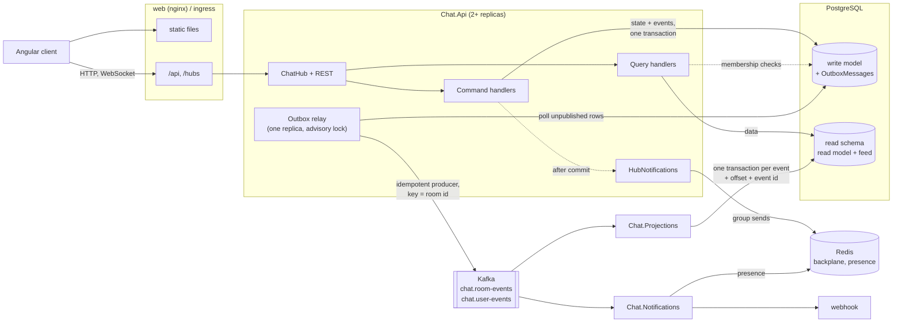
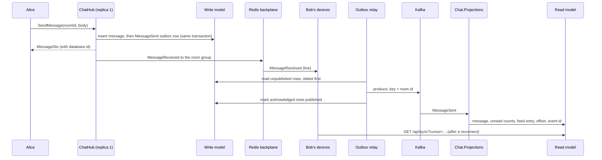

# realtime-chat-signalr

A real-time chat application: an ASP.NET Core 8 backend with a SignalR hub, Kafka as the
event log between a write side and a separately built read side, two worker services, and
an Angular 20 client.

- Public **channels** and **direct conversations** between two users
- **Presence** (online/offline) tracked per user across multiple connections, so a second
  tab or device keeps you online when the first closes; stored in Redis when running more
  than one instance
- **Typing indicators**, throttled on the server and expiring on their own on the client
- **Read receipts**, **per-device delivery receipts** and **unread counts**
- **Editing and deleting** your own messages, with every revision kept in the event log and
  queryable from the read model
- **@mentions**, highlighted in the client; a mentioned user with no open connection gets a
  notification (webhook, or the log) from the `Chat.Notifications` service
- **Multi-device sync**: each device keeps a cursor into a change feed and, after a
  reconnect, fetches everything since it, so all of a user's devices converge
- **Transactional outbox → Kafka**: every change is stored together with the event that
  describes it, and a relay publishes the events to Kafka with an idempotent producer,
  keyed by room id
- **CQRS with a separate read model**: queries never touch the write tables; they read a
  model that `Chat.Projections` builds from the Kafka topics, idempotently, and that can be
  rebuilt from them with `--rebuild`
- **Redis backplane** for running several API instances; the compose file starts two
  behind nginx
- **Per-connection rate limiting** and message size limits on the hub
- **Readiness/liveness endpoints**, a shutdown drain, **OpenTelemetry metrics** at
  `/metrics` and a Grafana dashboard
- **Kubernetes manifests** (Kustomize base with dev and prod overlays)

Sign-in uses a **development-only token endpoint** that issues a signed JWT for any user name
without a password. It stands in for a real identity provider and is disabled unless
`Auth:DevTokens:Enabled` is set.

## Architecture



Sending a message, end to end:



The live push to connected clients happens straight after the commit, in process, so it does
not wait for Kafka. Kafka feeds the read model and the notification service.

### Services

| Project | Runs as | Does |
|---------|---------|------|
| `Chat.Api` | `api` (2+ replicas) | REST and the SignalR hub; command handlers write the write model and the outbox; query handlers read the read model; one replica relays the outbox to Kafka |
| `Chat.Projections` | `projections` (1 replica) | Consumes both topics and maintains the read model; `--rebuild` replays them from the start |
| `Chat.Notifications` | `notifications` | Consumes room events and notifies mentioned users who are offline |
| `Chat.Contracts` | library | The published events and their JSON envelope |
| `Chat.Domain`, `Chat.Application`, `Chat.Infrastructure` | libraries | Aggregates; commands, queries and the dispatcher; EF Core, the outbox, Kafka, projections, presence, health and metrics |

The three services share the infrastructure library and are deployed separately. Without
Kafka (`Kafka:BootstrapServers` empty) the API keeps the event log in memory and runs the
projection itself, so it still works as one process for local development and tests.

## Running it

### With Docker Compose

```bash
docker compose up --build
# optionally with Prometheus on :9090 and Grafana on :3000
docker compose --profile observability up --build
```

Then open <http://localhost:8088> in two browsers (or a normal and a private window), sign
in as two different users and message each other. The sidebar footer shows which API
replica each browser is connected to.

| Service | What it does |
|---------|--------------|
| `postgres` | PostgreSQL 16: the write model, and the read model in the `read` schema |
| `redis` | Redis 7: SignalR backplane, presence, notification deduplication |
| `kafka` | Single-node Kafka 3.9 in KRaft mode (no ZooKeeper) |
| `migrate` | Runs the API image with `--migrate`: applies both sets of migrations and creates the topics, then exits |
| `api` | Two replicas of the API |
| `projections` | The read model projection |
| `notifications` | Mention notifications; set `CHAT_NOTIFICATION_WEBHOOK` to have them POSTed somewhere, otherwise they are logged |
| `web` | nginx serving the Angular build and proxying `/api` and `/hubs` |
| `prometheus`, `grafana` | Only with `--profile observability`; the dashboard is provisioned from `deploy/observability` |

The compose stack enables the dev token endpoint and uses a fixed signing key so it works
out of the box. Set `CHAT_JWT_SIGNING_KEY` to override the key, and do not expose this stack
publicly as it is.

### Locally

Requirements: .NET 8 SDK and Node.js (the client was built with Node 24).

```bash
# API on http://localhost:5288 (Development profile)
dotnet run --project src/Chat.Api

# Client on http://localhost:4200, proxying /api and /hubs to the API
cd client
npm install
npm start
```

The Development profile uses two SQLite files (`chat-dev.db` for the write model,
`chat-read-dev.db` for the read model, both created on startup), the in-memory event log
with the projection running inside the API, the in-memory presence tracker and no
backplane, so nothing else needs to be running. To use PostgreSQL, Redis and Kafka locally,
start them (for example with `docker compose up postgres redis kafka`) and set:

```bash
export Database__Provider=Postgres
export ConnectionStrings__Chat="Host=localhost;Database=chat;Username=chat;Password=chat"
export ConnectionStrings__ChatRead=""          # same database, "read" schema
export ConnectionStrings__Redis="localhost:6379"
export Kafka__BootstrapServers="localhost:9092"
dotnet run --project src/Chat.Api -- --migrate  # migrations + topics, then exits
dotnet run --project src/Chat.Api
dotnet run --project src/Chat.Projections
dotnet run --project src/Chat.Notifications
```

(The compose Kafka advertises itself as `kafka:9092`; to reach it from the host, add a
host listener or run the services in compose.)

### On Kubernetes

```bash
kubectl kustomize deploy/k8s/overlays/dev     # render
kubectl apply -k deploy/k8s/overlays/dev      # throwaway Postgres/Redis/Kafka included
```

`deploy/k8s/base` contains the API (Deployment, Service, HPA on CPU with a slow scale-down,
PodDisruptionBudget, readiness on `/health/ready`, liveness on `/health/live`), a migration
Job, the projections worker (one replica, `Recreate`), the notifications worker, the web front
end and an ingress-nginx Ingress with long proxy timeouts for WebSockets. The `prod` overlay
expects PostgreSQL, Redis and Kafka to exist, and a `chat-secrets` Secret to be created out
of band (see the comment in `overlays/prod/kustomization.yaml`). The manifests have been
rendered with `kubectl kustomize`; they have not been run against a production cluster.

### Tests

```bash
dotnet test
```

- `Chat.UnitTests`: domain rules (messages, edits and deletes, mentions, delivery markers),
  the dispatcher, command and query handlers against SQLite in memory, the outbox (rows
  written atomically with the change; the relay with a fake publisher, including partial
  acknowledgements), the projection (idempotency by offset and by event id, every event
  type, rebuild reproducing the same read model, the worker resuming from its checkpoint),
  the sync feed and cursors, the token bucket, the mention notifier with fakes, health and
  shutdown, metrics, the event envelope, the typing throttle, and a presence contract run
  against both trackers
- `Chat.IntegrationTests`: the whole API hosted with `WebApplicationFactory` and driven by
  the SignalR .NET client: messages, edits and deletes, receipts, delivery receipts, sync
  after being offline, rate and size limits, health and metrics endpoints; `BackplaneTests`
  starts two instances that share a database and Redis

The Kafka producer and consumer are exercised only through their in-memory counterparts and
fakes; no test runs against a Kafka broker. The Redis presence tests and the backplane tests
are skipped unless `CHAT_TEST_REDIS` is set:

```bash
docker run -d --rm --name chat-test-redis -p 6379:6379 redis:7-alpine
CHAT_TEST_REDIS=localhost:6379 dotnet test
```

CI (`.github/workflows/ci.yml`) builds and tests the backend with a Redis service, checks
that the migrations match the model, builds the Angular client and builds the compose images.

## Configuration

Settings use the normal ASP.NET Core configuration sources; in environment variables, `:`
becomes `__` (for example `ConnectionStrings__Redis`).

| Key | Default | Meaning |
|-----|---------|---------|
| `ConnectionStrings:Chat` | *(required)* | Write database connection string |
| `ConnectionStrings:ChatRead` | `Chat` (PostgreSQL) | Read model database. With PostgreSQL it may be the same database (tables live in the `read` schema); with SQLite it must be a separate file |
| `ConnectionStrings:Redis` | empty | When set: Redis presence and (by default) the backplane. When empty: in-memory presence, single instance only |
| `Database:Provider` | `Postgres` | `Postgres` or `Sqlite` |
| `Database:MigrateOnStartup` | `false` | Apply migrations (PostgreSQL) or create the schemas (SQLite) at startup |
| `Kafka:BootstrapServers` | empty | When empty, the event log is kept in memory and the API runs the projection itself |
| `Kafka:Topics:Rooms` / `Users` | `chat.room-events` / `chat.user-events` | Topics for room events (keyed by room id) and user events (keyed by name) |
| `Kafka:Partitions` / `ReplicationFactor` | `6` / `1` | Used when `--migrate` creates the topics |
| `Outbox:BatchSize` | `100` | Rows published per relay round |
| `Outbox:PollIntervalMilliseconds` | `1000` | Idle poll; saves on the same instance wake the relay immediately |
| `Outbox:RetentionHours` | `72` | How long published rows are kept before deletion |
| `Realtime:Limits:MessagesPerSecond` / `MessageBurst` | `5` / `10` | Token bucket per connection for send, edit and delete |
| `Realtime:Limits:MaximumReceiveMessageSizeBytes` | `16384` | Largest hub message; larger ones close the connection |
| `Realtime:Limits:MaxRequestBodySizeBytes` | `65536` | Largest HTTP request body |
| `Notifications:WebhookUrl` | empty | Where mention notifications are POSTed; empty means they are logged |
| `Notifications:RunInProcess` | `false` | Run the notifier inside the API (only without Kafka) |
| `Shutdown:DrainSeconds` | `0` | After SIGTERM, report not-ready for this long before stopping |
| `Shutdown:TimeoutSeconds` | `30` | Upper bound for the whole shutdown |
| `Redis:Backplane` | `true` | Use the SignalR Redis backplane when Redis is configured |
| `Redis:KeyPrefix` | `chat:` | Prefix for presence keys, notification claims and backplane channels |
| `Auth:Jwt:Issuer` / `Audience` | `realtime-chat` | Token issuer and audience |
| `Auth:Jwt:SigningKey` | *(required, 32+ chars)* | HMAC-SHA256 signing key |
| `Auth:Jwt:TokenLifetimeHours` | `12` | Lifetime of issued tokens |
| `Auth:DevTokens:Enabled` | `false` | Map `POST /api/dev/token` (password-less, development only) |
| `Presence:LeaseSeconds` | `90` | How long a connection counts as alive without renewal |
| `Presence:RenewIntervalSeconds` | `30` | How often each instance renews its leases and sweeps expired ones |
| `Typing:ThrottleMilliseconds` | `3000` | Minimum gap between typing broadcasts per user and room |
| `Typing:IndicatorMilliseconds` | `6000` | How long clients show the indicator after a broadcast |

## API surface

All endpoints except the token endpoint and the health and metrics endpoints require
`Authorization: Bearer <token>`. The hub accepts the token as the `access_token` query
parameter, which is what the SignalR client sends for WebSockets.

| Method | Path | |
|--------|------|-|
| POST | `/api/dev/token` | `{ "userName": "alice" }` returns a token (only when enabled) |
| GET | `/api/rooms` | Rooms you belong to, with unread counts |
| GET | `/api/rooms/unread` | Unread counts only |
| GET | `/api/rooms/{id}` | One room |
| GET | `/api/rooms/{id}/messages?before=&after=&limit=` | Keyset-paged history (limit 1-100); deleted messages come back as tombstones |
| POST | `/api/rooms/{id}/messages` | Send a message (same command as the hub) |
| PUT / DELETE | `/api/rooms/{id}/messages/{messageId}` | Edit (`{ "body": "..." }`) or delete your own message |
| GET | `/api/rooms/{id}/messages/{messageId}/revisions` | Every version of a message's text |
| GET | `/api/rooms/{id}/read-markers` | How far each member has read |
| POST | `/api/rooms/{id}/read` | `{ "messageId": 42 }` marks read up to a message |
| GET | `/api/rooms/{id}/deliveries` | How far each member's devices have received |
| POST | `/api/rooms/{id}/delivered` | `{ "messageId": 42, "deviceId": "..." }` records a delivery |
| GET | `/api/sync?cursor=&limit=` | Changes in your rooms after a cursor; without one, the current head |
| GET / POST | `/api/channels` | List channels / create one |
| POST | `/api/channels/{id}/join` | Join a channel |
| POST | `/api/direct` | `{ "userName": "bob" }` opens (or returns) the direct conversation |
| GET | `/api/users` | Users who have signed in |
| GET | `/api/presence` | Users online now |
| GET | `/health/live`, `/health/ready`, `/health` | Liveness, readiness (databases, Redis, draining), liveness alias |
| GET | `/metrics` | Prometheus scrape endpoint (every service) |

Hub `/hubs/chat?deviceId=...`: client-to-server `SendMessage`, `EditMessage`,
`DeleteMessage`, `MarkRead`, `MarkDelivered` (needs a `deviceId`), `StartTyping`,
`StopTyping`, `GetOnlineUsers`, `GetConnectionInfo`; server-to-client `MessageReceived`,
`MessageEdited`, `MessageDeleted`, `ReadReceipt`, `DeliveryReceipt`, `UserTyping`,
`UserStoppedTyping`, `PresenceChanged`, `RoomAdded`, `MemberJoined`.

## Design decisions

**The write side stores state; the read side is built only from events.** Command handlers
load aggregates through `ChatDbContext`, change them and save, as before. What is new is
that every change also produces a published event (`MessageSent`, `MessageEdited`,
`MessageDeleted`, `MemberJoined`, `ReadReceiptRecorded`, `DeliveryRecorded`, `RoomCreated`,
`UserRegistered`), and the read model is derived from those events alone. Aggregates are
not rebuilt from events, so this is event sourcing of the read side, with Kafka as its
system of record, rather than of the aggregates themselves.

**A transactional outbox, written in the same transaction.** `SaveChangesAsync` maps the
domain events to contracts, serializes them into `OutboxMessages` and commits once. Message
ids come from the database, so the outbox rows are added by a second save inside the same
transaction. Either the change and its events are stored, or neither is.

**One relay, publishing in order, at least once.** Every API replica runs the relay loop, but
only the one holding a PostgreSQL advisory lock (on a dedicated, unpooled connection)
publishes; if it dies, the lock goes with its session and another replica takes over. It
reads the oldest unpublished rows, hands them all to an idempotent producer (`acks=all`)
keyed by room id, and marks as published only the prefix the broker acknowledged. A failure
therefore leads to re-sending, never to a gap or a reordering within a room.

**Projections are idempotent twice over.** Each event is applied in its own read-model
transaction that also records the partition's offset and the event id. An offset at or below
the checkpoint is skipped (a replay after a crash), and an event id already seen is ignored
(a re-sent duplicate at a new offset). The handlers themselves are also written to be no-ops
on repeat. A failing event is retried with back-off rather than skipped. Partitions resume
from the checkpoints in the read model, not from the consumer group's offsets, which is what
makes `--rebuild` work: it empties the read model and its checkpoints, and every partition
is read again from offset 0. The topics are created with infinite retention and without
compaction for that reason.

**Reads lag writes, so some reads go to the write model on purpose.** The read model is
eventually consistent. Responses to commands that the caller needs at once (create a
channel, join, open a direct conversation) are built from the write model
(`GetCurrentRoomSummaryQuery`), and so are membership checks: hub group membership and
access decisions must not trail a join. Everything else (history, room lists, unread
counts, receipts, users, sync) comes from the read model.

**Sync cursors carry an epoch.** The projection appends each change to a feed whose positions
are assigned by the read database in commit order; a single projection replica keeps that
order meaningful. A cursor is `epoch.position`; a rebuild generates a new epoch, so a device
holding an old cursor gets `reset: true` and reloads instead of silently skipping changes.
A device without a cursor gets the head first and then loads its state, so nothing falls in
between. Message entries return the message as it is now, so replaying converges.

**Delivery is per device, reading is per user.** A device id (chosen by the client, sent on the
hub connection) lets the server keep one delivery marker per device, which only moves
forward; read markers stay per user, as before.

**Notifications only for people who are offline.** The notifier checks the shared presence in
Redis; someone with an open connection already sees the highlighted mention. A Redis
`SET NX` claim per event and user keeps a replayed event from notifying twice, and a failed
send gives its claim back so the retry delivers it. A new consumer group starts at the end of
the log, so deploying the service does not notify about old mentions.

**Rate limits per connection.** A hub filter gives each connection a token bucket on connect
and refuses message commands once it is empty, so one client cannot flood a room or the
outbox. Typing has its own throttle; reads are not limited.

**Readiness is not liveness.** `/health/live` checks nothing, so a database outage does not get
every pod restarted; `/health/ready` checks the databases, Redis and whether the host is
draining. On shutdown the host reports not-ready for `Shutdown:DrainSeconds` before Kestrel
stops, so the load balancer moves new connections elsewhere first; SignalR clients
reconnect automatically.

**Broadcasts come from events, not from the hub.** The hub runs the command and returns the
result to the caller; `HubNotifications` sends to the room's group after the commit. Sending
through `POST /api/rooms/{id}/messages` therefore reaches connected clients too.

**Message ids are the cursor for history.** Ids are database-generated and increase in
insertion order, so history pages with `WHERE Id < @before ORDER BY Id DESC`, served by an
index on `(RoomId, Id)` in the read model.

**Presence is per connection, with leases.** A user is online while they have at least one
live connection. In Redis that is an `online` set plus a sorted set per user of connection
ids scored by lease expiry; connect, disconnect and the expiry sweep each run as one Lua
script. Every instance renews its own connections' leases; connections of a crashed instance
expire and their users go offline.

**No sticky sessions.** The browser client connects with WebSockets and `skipNegotiation`, so
nginx and the ingress can round-robin, and the backplane delivers across instances.

**A hand-rolled dispatcher instead of MediatR**, and **SQLite for development and tests**,
as before: the handler tests use a real relational database so unique indexes, identity
columns and filtered includes behave as they do in PostgreSQL.

## Observability

Every service exports OpenTelemetry metrics at `/metrics`:

| Metric (Prometheus name) | Meaning |
|--------------------------|---------|
| `chat_connections_active` | SignalR connections open on an API instance |
| `chat_messages_sent_total` | Messages committed |
| `chat_hub_rate_limited_total` | Hub invocations refused by the rate limit, by method |
| `chat_outbox_published_total`, `chat_outbox_failures_total` | Events acknowledged by Kafka; relay rounds that left rows behind |
| `chat_projection_events_total` | Events handled by the projection, by outcome (Applied, Duplicate, AlreadyProjected, Unreadable) |
| `chat_projection_lag_seconds` | Age of the most recently projected event when it was applied |
| `chat_notifications_sent_total` | Mention notifications sent |

ASP.NET Core's request, Kestrel and SignalR connection metrics and the .NET runtime metrics
are exported as well. `deploy/observability/grafana/dashboards/realtime-chat.json` is a
dashboard over these series (connected clients, messages per second, projection lag, outbox,
notifications, request latency); compose provisions it with `--profile observability`.

## Production considerations

What would still need attention before running this for real users:

- **Identity.** The dev token endpoint must stay off; a real identity provider has to issue
  the JWTs, and the signing key belongs in a secret store.
- **Kafka.** The compose and dev setups run a single broker with replication factor 1. A real
  cluster needs at least three brokers, `ReplicationFactor` 3 and `min.insync.replicas` 2 on
  the topics, TLS/SASL (the client currently connects in plaintext), and monitoring of
  consumer lag in addition to the lag metric here.
- **Event retention and privacy.** Topics keep everything forever so the read model can be
  rebuilt. A deleted message is a tombstone in the read model, but its earlier text is still
  in the log. Honouring erasure requests would need crypto-shredding (per-user or per-room
  keys) or a compacted snapshot strategy.
- **Schema evolution.** Events are JSON with the record name as the type. Changes must stay
  backward compatible (add optional fields only); a schema registry would make that
  enforceable.
- **Projection throughput.** The projection applies one event per transaction on a single
  replica, which keeps feed positions in commit order but bounds throughput. Scaling it out
  would need per-partition (per-room) cursors instead of one global feed position.
- **Rebuilds.** `--rebuild` empties the live read model, so queries see a partly rebuilt model
  until it catches up. A safer procedure is to rebuild into a second schema and switch the
  API's `ChatRead` connection when it has caught up.
- **Read-your-writes.** Apart from the cases above that read the write model, a client can
  briefly read state older than its own last command; the client is written for that, other
  consumers of the API may not be.
- **Existing data.** Upgrading a database that already held messages before the outbox
  existed leaves the read model without them; a one-off backfill that writes outbox rows from
  the current tables would be needed.
- **Growth.** `ProcessedEvents` and the sync feed grow without bound and would need pruning
  (for example, ids older than the topic's oldest offset still in use, feed entries older than
  any device could reasonably hold).
- **Load.** No load tests have been run; connection counts, message rates and HPA thresholds
  are untested defaults.

## Known limitations

- The dev token endpoint is the only way to sign in.
- Mention notifications are sent for new messages, not for mentions added by an edit.
- A change committed but not yet projected when a device syncs is picked up by that device's
  next sync, not by the current one (live pushes cover connected devices meanwhile).
- Users are names only; there are no profiles, avatars or attachments.
- The presence sweep reads the whole online set on each tick, which suits small deployments.

## Project layout

```
src/
  Chat.Contracts/        Published events and the JSON envelope
  Chat.Domain/           Rooms, members, messages, delivery markers, users; invariants and domain events
  Chat.Application/      Commands, queries, dispatcher, read model views, sync cursor, presence and typing
  Chat.Infrastructure/   EF Core write model and outbox, read model and projector, Kafka, presence,
                         notifications, health checks, shutdown drain, metrics
  Chat.Api/              Minimal API endpoints, ChatHub, rate limit filter, event-to-hub notifications, JWT
  Chat.Projections/      Worker host for the projection (--rebuild)
  Chat.Notifications/    Worker host for mention notifications
tests/
  Chat.UnitTests/        Domain, handlers, outbox, projection, sync, notifier, limits (SQLite and fakes)
  Chat.IntegrationTests/ WebApplicationFactory + SignalR client
client/                  Angular 20 client (standalone components, signals)
deploy/
  k8s/                   Kustomize base, dev and prod overlays
  observability/         Prometheus scrape config, Grafana provisioning and dashboard
docker-compose.yml       postgres, redis, kafka, migrate, api x2, projections, notifications, web
```

## License

[MIT](LICENSE)
